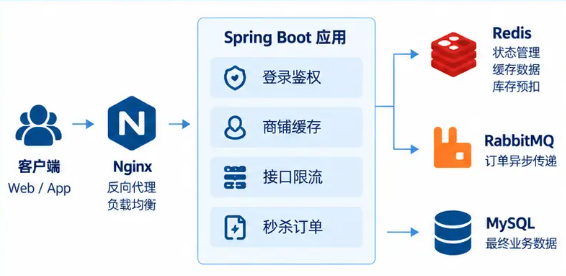
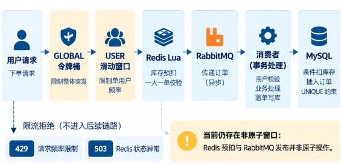

# 高并发本地生活服务平台｜Java 后端工程化改造

本项目基于点评课程项目进行**工程化二次改造**，保留课程的商铺、登录、探店等业务。我的工作聚焦**秒杀订单链路、接口流量治理和真实实验验证**。

## 项目简介

技术栈：Spring Boot、MySQL、Redis、RabbitMQ、Nginx。前端沿用课程页面。Redis 处理登录状态、商铺缓存、限流和秒杀资格预扣；RabbitMQ 异步传递订单；MySQL 保存最终订单和库存。

## 我的核心改造

| 维度 | 原实现 | 当前实现 | 为什么改 / 如何验证 |
| --- | --- | --- | --- |
| 异步订单 | Redis Stream + 手写消费线程、pending 处理 | Redis Lua 预扣后发布 RabbitMQ，由 Spring Listener 消费 | 收敛消费循环；真实 Controller → Lua → MQ → MySQL 集成验收 |
| 消费失败与事务 | 异常处理依赖手写循环，落库方法未生效事务 | 最多 3 次本地尝试，耗尽转错误队列；独立事务 Bean | 防无限重试；故障、回滚测试通过 |
| 一人一单 | Redis 前置判断和业务查重 | 保留前置判断，增加 `(user_id,voucher_id)` UNIQUE | 真实并发唯一键冲突测试验证只保留一单、库存回滚 |
| 秒杀限流 | 无两级入口限流 | GLOBAL Token Bucket → USER Sliding Window Counter | Redis Lua、AOP/HTTP 组合测试；同用户 10 次请求有 5 次 429 |
| 验证码与状态码 | 无发送冷却；无明确限流 HTTP 语义 | 60 秒冷却；过快返回 429，限流依赖故障返回 503 | Redis 与 HTTP 组合测试 |
| SQL 决策 | 未留真实执行计划基线 | 核对数据量、索引与 EXPLAIN，暂不加索引 | 券表 1 行、笔记表 4 行，当前无可证实的索引收益 |
| 端到端验证 | 缺少本轮缓存对照与跨组件对账 | 冷/热缓存实验；独立账号秒杀及 Redis/MQ/MySQL 对账 | 热读 37,994 次对应 MySQL 查询 0；200/200 独立请求最终落库 |

## 技术架构

```text
客户端 → Nginx → Spring Boot（登录鉴权 / 商铺缓存 / 接口限流 / 秒杀订单）
                         ├→ Redis：会话、缓存、限流与秒杀预扣
                         ├→ RabbitMQ：异步订单传递与错误消息留存
                         └→ MySQL：业务数据、订单与最终库存约束
```



## 秒杀核心链路

登录后的请求依次经过 **GLOBAL 限流 → USER 限流 → Redis Lua（库存预扣、一人一单）→ RabbitMQ → Consumer → MySQL（条件扣库存、UNIQUE 约束）**。接口返回 orderId 仅表示 Lua 接受且发布调用已返回；最终是否落库需等待消费并核对订单。消费端有限重试、错误队列和数据库幂等保障已进入队列的订单处理；Spring AUTO ACK 在 Listener 成功返回后确认消息。



## 性能验证

| 实验 | 本地证据 | 工程决策 |
| --- | --- | --- |
| SQL / 索引 | 真实 MySQL EXPLAIN；券表 1 行、笔记表 4 行 | 保留 SQL 与索引，数据规模不足以证明新增索引有收益 |
| 商铺缓存 | 100 threads / 15s；失效窗口 12 次 MySQL 回源；热缓存 37,994 次请求、MySQL 查询 0 | 保留课程已有 Cache-Aside 实现，记录并发回源边界 |
| 秒杀全链路 | 200 个独立账号全部落库，Redis/MQ/MySQL 对账一致；两轮阶梯实验均在 300 线程档首次出现 `Connection refused` | 定位本机突发 HTTP 建连/接入边界，暂不据此调参 |

请求数和完成速率只描述本地固定条件下的实验，不代表生产持续容量。

## 工程权衡与边界

- Redis 预扣与 MQ 发布非原子；生产者未启用 Confirm / Return，也无自动补偿。返回 orderId 不保证 broker 已可靠接收。
- MySQL commit 与 MQ ACK 非原子，可能重复投递；事务、条件更新和 UNIQUE 保障业务键幂等，不能宣称端到端 exactly-once。
- 错误队列需要人工核对；错误转发也没有发布确认。旧 Stream 积压不会自动迁移。
- 本地同机短批次压测无法定义生产容量，也未定位 HTTP 连接拒绝的唯一根因。

## 本地运行

需要兼容 Java 8 编译目标的 JDK、Maven、Docker Desktop、本地 MySQL `hmdp` 数据库和前端 Nginx 目录。初始化 SQL 只用于新库；已有库应先核对重复 `(user_id,voucher_id)`，再手工执行[唯一索引增量脚本](src/main/resources/db/migration/20260909_voucher_order_unique.sql)，不要覆盖已有库。

在 PowerShell 中设置本机连接信息（不要提交凭据），再启动后端：

```powershell
$env:MYSQL_URL = 'jdbc:mysql://127.0.0.1:3306/hmdp?useSSL=false&serverTimezone=UTC'
$env:MYSQL_USERNAME = 'your-local-user'
$env:MYSQL_PASSWORD = (Get-Credential -UserName $env:MYSQL_USERNAME).GetNetworkCredential().Password
$env:RABBITMQ_HOST = '127.0.0.1'
$env:RABBITMQ_PORT = '5672'
$env:RABBITMQ_USERNAME = 'your-local-user'
$env:RABBITMQ_PASSWORD = (Get-Credential -UserName $env:RABBITMQ_USERNAME).GetNetworkCredential().Password
$env:RABBITMQ_VIRTUAL_HOST = '/'
.\start-backend.ps1 -StartRabbitMq
```

若已有 RabbitMQ 实例，用 `.\start-backend.ps1`。脚本启动项目 Redis 并打包运行后端。前端需从仓库同级的 `nginx-1.18.0` 目录启动 Nginx，访问 `http://localhost:8080/`；后端为 `http://localhost:8081/`。上传目录默认指向该 Nginx 目录下的 `html/hmdp/imgs`，其他位置可设置 `HMDP_IMAGE_UPLOAD_DIR`。首次使用新 Redis 卷，可单独运行 `mvn -B '-Dtest=HmDianPingApplicationTests#loadShopData' test` 导入 GEO 商铺索引；不要直接运行包含大量写入的全部教学测试。

不依赖中间件的筛选回归：

```powershell
mvn -B '-Dtest=SeckillMigrationTest,VoucherOrderTransactionTest,NormalTest' test
```

