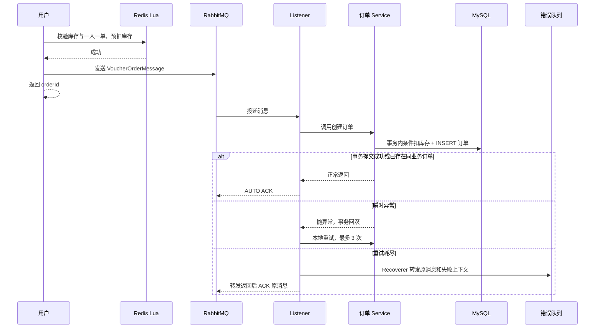

# 秒杀 RabbitMQ 消费可靠性：初学者面试导读

这份导读帮助你把本项目的“Redis Lua + RabbitMQ 异步下单”讲清楚。目标不是背术语，而是能从一次真实订单消息出发，解释它为什么能异步、何时确认、失败怎么办、重复投递为什么不会多扣库存，以及哪些问题目前还没有解决。

开始前建议先读 [消费端可靠性与幂等](../任务总结/seckill-consumer-reliability.md)。它记录了当前实现、真实测试和限制；[工程演进日志](../engineering-log.md) 记录了从 Redis Stream 迁移到 RabbitMQ 的原因和过程；[项目面试复盘](../interview-notes.md) 适合作为考前速记。

## 先用一句话理解项目

用户请求秒杀时，Redis Lua 先原子判断库存和一人一单，并预扣 Redis 库存。通过判断后，应用发送一条订单消息到 RabbitMQ，接口立即返回 orderId。消费者收到消息后，在 MySQL 事务内做条件扣库存和创建订单；如果消费失败，先做有限次数本地重试，仍失败就保留到错误队列；如果消息重复，MySQL 唯一索引保证最终只会有一个用户-券订单。

把这段话拆开，才是面试官真正会追问的内容。

## 文件阅读顺序

不要一上来读完整 Service。按下面顺序，每一步先回答“输入是什么、输出是什么、失败会发生什么”。

| 顺序 | 文件 | 阅读重点 | 读完应能回答 |
|---|---|---|---|
| 1 | [SeckillMqConstants.java](../src/main/java/com/hmdp/utils/SeckillMqConstants.java) | 主交换机、业务队列、路由键和错误拓扑的统一名称 | 一条订单消息从哪里进、失败后去哪里？ |
| 2 | [VoucherOrderMessage.java](../src/main/java/com/hmdp/dto/VoucherOrderMessage.java) | 消息契约只有 orderId、userId、voucherId | 为什么不能把 `VoucherOrder` 实体直接发到 MQ？ |
| 3 | [seckill.lua](../src/main/resources/seckill.lua) | Redis 库存判断、Set 一人一单、预扣 | Lua 解决了什么并发问题，又没有解决什么？ |
| 4 | [VoucherOrderServiceImpl.java](../src/main/java/com/hmdp/service/impl/VoucherOrderServiceImpl.java) | 生成 orderId、执行 Lua、发送消息、用户锁、重复键异常的事务外处理 | 什么情况下接口返回 orderId，是否表示 MySQL 已成功？ |
| 5 | [SeckillRabbitConfig.java](../src/main/java/com/hmdp/config/SeckillRabbitConfig.java) | durable 拓扑、JSON converter、Recoverer | 错误消息包含什么，为什么需要单独错误队列？ |
| 6 | [application.yaml](../src/main/resources/application.yaml) | AUTO ACK、3 次 stateless retry、1 秒/2 秒 backoff、不无限 requeue | 重试三次到底是三次还是四次？ |
| 7 | [VoucherOrderListener.java](../src/main/java/com/hmdp/listener/VoucherOrderListener.java) | Listener 只做日志和委托，不吞异常 | 为什么 Listener 不能 catch 后只记录日志？ |
| 8 | [VoucherOrderPersistenceService.java](../src/main/java/com/hmdp/service/impl/VoucherOrderPersistenceService.java) | `@Transactional`、查重、`stock > 0` 条件 UPDATE、INSERT | 事务为什么放到独立 Bean？ |
| 9 | [增量索引 SQL](../src/main/resources/db/migration/20260909_voucher_order_unique.sql) 和 [建表 SQL](../src/main/resources/db/hmdp.sql) | `(user_id, voucher_id)` UNIQUE；已有库的部署前检查 | Redis 已经一人一单，为什么仍要数据库 UNIQUE？ |
| 10 | [SeckillConsumerReliabilityTest.java](../src/test/java/com/hmdp/SeckillConsumerReliabilityTest.java) | 六项真实 Redis/RabbitMQ/MySQL 验收 | 代码声称“幂等”时，如何证明而不是相信？ |

阅读第 4、7、8 步时，把调用关系画成一条线：`Listener → VoucherOrderServiceImpl → VoucherOrderPersistenceService`。只有最后一个类的方法带 `@Transactional`，而且它通过另一个 Spring Bean 被调用，所以事务代理才会生效。

## 一条消息的生命周期



这里有两个容易混淆的点。

第一，接口返回 orderId 只表示 Lua 已允许抢购，而且 `RabbitTemplate.convertAndSend()` 调用正常返回；它不表示 RabbitMQ 已经通过 Confirm 确认，也不表示消费者已经把订单写入 MySQL。本阶段按要求没有 Confirm、Return、生产者阻塞重试或补偿。

第二，AUTO ACK 不是“消息一到就 ACK”。本项目中，Listener 方法正常返回才会被框架视为成功。事务在 Service 内提交失败会抛回 Listener；Listener 不吞异常，因此不会错误确认。

## 必须真正理解的五个知识点

### 1. Redis Lua：快，但不是最终订单事实

Lua 在 Redis 内一次执行库存检查、用户是否已抢、库存减一、用户加入资格 Set，避免多条 Redis 命令在并发时被穿插。它适合做高并发入口过滤，能快速拒绝库存不足和同用户重复请求。

但 Lua 的结果只是 Redis 侧的资格和预扣，不是最终订单。RabbitMQ 可能重复投递，MySQL 可能有其他写入入口，Redis 与 MQ 也不是同一事务。因此 Redis 不能替代数据库唯一约束。

### 2. 至少一次消费与幂等

消息系统常见的是“至少一次”语义：例如 MySQL 已提交，但 ACK 因进程断连没有送达，broker 可能再次投递同一条消息。正确目标不是假装消息只来一次，而是让重复处理的最终业务结果保持不变。

这里的幂等键是 `(user_id, voucher_id)`，而不是 `orderId`。同一个用户对同一张券只能有一个订单；不同 orderId 的重复业务消息也必须被拦住。

### 3. 事务与唯一键异常的顺序

订单事务内的顺序是：查重 → 条件扣库存 → 插入订单。两个重复消息并发时，可能都在查重时看不到订单，随后都尝试扣库存和插入。

数据库 UNIQUE 只允许其中一个 INSERT 成功。失败的一方必须让 `DuplicateKeyException` 离开 `@Transactional` 方法，这样本次事务会回滚，前面的库存 UPDATE 一起回滚。外层再查询同一业务键，确认订单确实已存在后，才能把这条重复消息视为成功处理。

错误写法是：在事务内部 catch 唯一键异常后直接 return。这样事务可能正常提交，已经执行的库存 UPDATE 会留下，导致重复消息多扣库存。

### 4. 条件更新防超卖

库存操作不是“先 SELECT 库存，再在 Java if 判断后 UPDATE”，因为读与写之间可能有别的事务修改库存。本项目使用等价 SQL：

```sql
UPDATE tb_seckill_voucher
SET stock = stock - 1
WHERE voucher_id = ? AND stock > 0;
```

返回更新行数为 0 就说明数据库库存已不足，事务抛异常而不是创建订单。这是数据库侧的最终防超卖控制。

### 5. retry、requeue、错误队列不是同一件事

本地 retry 是消费者线程在当前消息处理过程中再次调用业务代码。本项目总共尝试三次：首次、等待 1 秒后的第二次、等待 2 秒后的第三次。每一次都是新数据库事务，因为事务在 retry 回调内部。

requeue 是把消息重新放回 broker 业务队列。无限 requeue 会让持续失败消息反复占用消费者，因此配置了 `default-requeue-rejected: false`。

错误队列是三次耗尽后由 `RepublishMessageRecoverer` 主动转发的持久消息。它保留原 JSON 和 `x-exception-*`、原交换机、原路由键，方便在控制台人工核对。它不是自动重放机制，也不是 broker DLX。

## 高频问题与可直接练习的成段回答

### 为什么从 Redis Stream 换成 RabbitMQ？

“原实现把秒杀订单写入 Redis Stream，并在业务 Service 内维护消费组、后台线程、ACK 和 pending-list 恢复。当前改造使用 RabbitMQ 的交换机、队列和 Spring Listener 承担消息路由与消费者生命周期，业务 Service 只保留订单业务。选择并不是因为 Redis Stream 一定性能更差，而是项目希望将订单异步消费、失败重试和错误消息观察放到专门的消息模型里。Redis 仍用于 Lua 原子资格校验和库存预扣。两者职责分开后，消费端的可靠性策略更清晰。”

### AUTO ACK 怎样保证不会在数据库提交前确认？

“这里采用 Spring AMQP 的 AUTO ACK，不是 no-ack。Listener 只委托 Service，业务异常不 catch 吞掉。事务方法在独立 Bean 上，提交成功后方法才会正常返回；如果扣库存、插单或提交失败，异常会传回 Listener，框架不会把这次调用当作成功。对于重试耗尽的消息，Recoverer 转发到错误队列正常返回后，原消息才被 ACK。MySQL 与 RabbitMQ ACK 不是一个分布式事务，所以提交后 ACK 丢失仍可能造成重投，这正是数据库幂等约束存在的原因。”

### 为什么重试选 stateless，而不是 stateful？

“不能只因为有数据库事务就选择 stateful，要看事务和 retry 的嵌套关系。本项目没有 Listener 外层事务和 `channelTransacted`，`@Transactional` 在每次业务调用内部开启。一次失败先完整回滚，retry 再发起下一次新的业务调用和新事务，所以 stateless 更符合当前模型，也更容易分析。当前 Spring AMQP 2.2.18 的文档也说明：事务在 retry callback 内部开启时适合 stateless；若有必须跨消息重投维持的外层事务，才需要 stateful。”

### 重复消息为什么不会重复扣库存？

“有三层保护。第一层 Lua 在入口用 Set 快速拦截同一用户重复请求。第二层业务事务开始时查 MySQL 是否已有该用户和券的订单，已存在就直接返回。第三层也是最终保障，数据库有 `(user_id, voucher_id)` UNIQUE。若两条消息同时查重未命中，只有一个 INSERT 能成功；失败方的唯一键异常会触发整个事务回滚，所以它此前执行的条件扣库存也会回滚。事务外确认相同业务订单已经存在后，这条消息作为幂等成功结束。真实并发测试模拟了 Redis 锁不互斥，并确认只生成一个订单、库存只减一次。”

### 为什么不能在事务内部捕获 DuplicateKeyException 后直接返回成功？

“因为插订单之前已经执行库存 UPDATE。若事务内部 catch 后正常 return，Spring 可能把事务当作成功并提交，第二条重复消息虽然没有插入订单，却留下了一次库存扣减。正确处理是让异常先穿过事务代理触发回滚；外层没有同一个数据库事务，再查询同一个 userId/voucherId 的订单是否已经存在。只有业务键确实存在，才能把重复消费当作成功；如果是无关主键冲突，还要继续抛异常进入重试或错误队列。”

### 为什么需要错误队列，失败时直接丢弃不行吗？

“短暂数据库抖动可以通过有限次数本地重试恢复，但持续失败需要保留现场。直接丢弃会让订单消息和异常原因都无法排查；无限 requeue 又会让毒消息反复占用消费者。这里三次尝试耗尽后，Recoverer 将原 JSON、异常信息、原 exchange 和 routing key 转发到持久错误队列。运维或开发可以在控制台看到消息，再核对 MySQL 是否已产生订单并决定如何处理。当前没有自动回放，避免在不了解失败原因时盲目重放。”

### durable 与 persistent 是否保证绝不丢消息？

“不能。durable 让交换机和队列在 broker 重启后保持定义，persistent 让 broker 已接收的消息按持久消息处理。它们不能覆盖生产者发送到 broker 前的失败，也不能覆盖没有 Confirm 时的不确定结果。本项目还存在 Redis 预扣成功但 MQ 未成功的窗口，以及错误转发没有 Confirm 的窗口。因此当前能说明消费端有有限重试、错误消息保留和数据库幂等，不能声称端到端绝不丢失或 exactly-once。”

### 错误队列和 DLQ 有什么区别？

“DLQ 一般是 broker 根据死信规则自动把被拒绝、过期或满队列消息转发到死信交换机。本项目没有配置 broker DLX，而是在本地 retry 用尽后，由 `RepublishMessageRecoverer` 主动发送到错误交换机。它的优势是能添加异常栈、原 exchange 和路由键等应用上下文。两者都能形成失败消息的停放处，但触发方和附带的信息不同。”

## 面试追问时的答题框架

面对“你怎么保证可靠性”这种宽泛问题，不要直接说“保证不丢”。用四步回答：

1. 先说明目标和边界：消费端按至少一次处理，目标是重复不产生重复业务效果。
2. 说明正常路径：AUTO ACK 在事务成功返回后发生，库存和订单同一事务。
3. 说明失败路径：三次 stateless retry；耗尽转发错误队列；不无限 requeue。
4. 说明未解决风险：没有 Confirm/Return，Redis 与 MQ 不是原子操作，错误转发也不是原子可靠；因此不承诺 exactly-once。

这种回答比罗列“Redis、RabbitMQ、MySQL、Redisson”更能显示你理解了因果关系。

## 动手练习与自检

### 练习 1：跟踪一次正常订单

在专用 RabbitMQ virtual-host 中执行 README 的集成测试命令。阅读 `normalMessageAndSequentialRedeliveryOnlyDeductOnce`，然后回答：第一次和第二次消息各走到哪个 Service 分支？为什么库存从 5 只变成 4？

### 练习 2：观察错误消息

执行 `exhaustedRetriesRepublishPersistentMessageWithFailureContext`，在错误队列观察 `delivery_mode=2`、`x-exception-message`、`x-original-exchange` 和原 JSON。不要对验收样例直接重放；先判断它是否已经有订单、失败原因是否已修复。

### 练习 3：证明不是只靠 Redis 锁

阅读 `databaseUniqueRaceRollsBackLoserEvenWithoutRedisLock`。该测试故意让锁失去互斥，并用屏障让两个事务同时查重。你应该能解释为什么真实 UNIQUE 冲突是必要断言，以及为什么只断言“最终一单”还不够。

### 考前自检

- 我能区分接口返回 orderId、broker 收到消息、MySQL 提交三个不同时间点。
- 我能解释 AUTO ACK、retry、requeue、错误队列的区别。
- 我能说明 UNIQUE 冲突必须先回滚再去重。
- 我知道本项目为什么使用 stateless retry，而不是机械地说“有事务就 stateful”。
- 我能诚实说出未开 Confirm/Return 后仍有的风险。

## 可引用的代码与验收证据

- [消费可靠性设计与实际验收](../任务总结/seckill-consumer-reliability.md)：23 个筛选测试、进程重启和控制台验证。
- [测试类](../src/test/java/com/hmdp/SeckillConsumerReliabilityTest.java)：正常、重复、并发、重试、错误队列、连接重建六类场景。
- [错误队列配置](../src/main/java/com/hmdp/config/SeckillRabbitConfig.java)：持久拓扑和 `RepublishMessageRecoverer`。
- [订单事务](../src/main/java/com/hmdp/service/impl/VoucherOrderPersistenceService.java)：查重、条件扣库存、插单。
- [事务外幂等判断](../src/main/java/com/hmdp/service/impl/VoucherOrderServiceImpl.java)：只对确认的业务重复消息返回成功。
- [Spring AMQP 2.2 重试与事务说明](https://docs.spring.io/spring-amqp/docs/2.2.6.RELEASE/reference/html/)：当前依赖版本对应的官方说明。

面试时不要把测试结果说成性能数据。本项目实际验证了功能正确性和失败路径；没有做吞吐、延迟或 broker 宿主机断电恢复压测。
