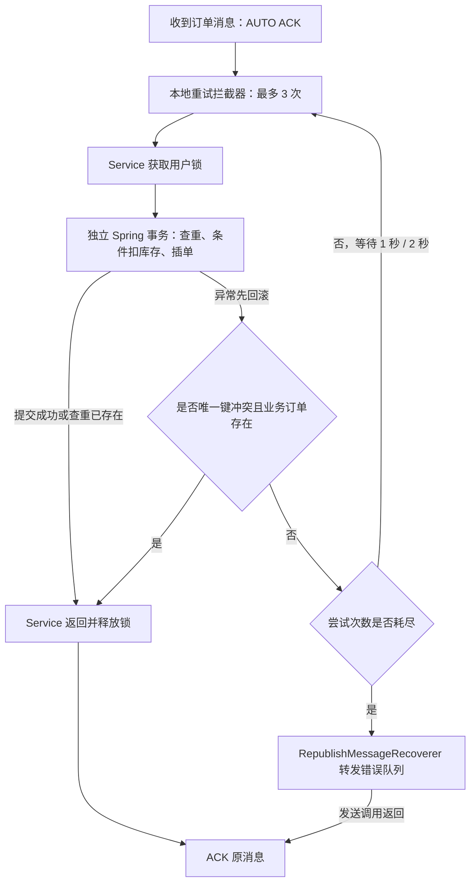

# 秒杀消费端可靠性与幂等

## 当前流程

主链路沿用上一阶段：Controller → Lua 预扣与一人一单快速校验 → RabbitTemplate JSON DTO → `hmdp.seckill.direct` / `seckill.order.create` → `hmdp.seckill.order.queue` → VoucherOrderListener → VoucherOrderServiceImpl → VoucherOrderPersistenceService → MySQL。

没有另建订单架构，旧 Redis Stream 消费代码仍不存在。消息体为 VoucherOrderMessage（orderId/userId/voucherId），主拓扑和错误拓扑名称统一在 SeckillMqConstants。

## ACK 与事务边界

Listener 不捕获并吞掉异常，也不手写 basicAck/basicNack。Spring AUTO 的成功确认发生在 Listener 返回之后；业务方法通过独立 Bean 的事务代理调用，提交异常同样会抛回 Listener，不会当成成功。

事务方法之外的 Service 负责用户锁和 DuplicateKeyException 判定。异常先离开事务代理，库存 UPDATE 被回滚，随后执行新的业务键查询；只有确认 `(userId, voucherId)` 已存在才返回幂等成功。不存在对应订单的主键冲突继续抛出，进入有限重试/错误队列，不泛化吞掉所有 DataIntegrityViolationException。

## 为什么使用 stateless retry

项目实际依赖 Spring Boot 2.3.12 / Spring AMQP 2.2.18。根据该版本实现和官方说明，事务在 retry callback 内部开启时适合 stateless；已有事务包在 retry 外侧、必须跨重投递回滚时才需要考虑 stateful。本项目没有 Listener 容器外层数据库事务，也没有 channelTransacted，每一次尝试都会重新进入业务事务代理，因此明确设置 `stateless: true`。

- `enabled: true`，`max-attempts: 3` 包含首次执行，共至多三次。
- 初始间隔 1 秒、倍率 2、上限 4 秒；本配置实际等待 1 秒、2 秒。
- `default-requeue-rejected: false`，避免耗尽后无限 broker requeue。
- Boot 自动将 MessageRecoverer Bean 接入该重试拦截器，没有额外叠加一套手写重试。

参考：[Spring AMQP 2.2 重试与事务说明](https://docs.spring.io/spring-amqp/docs/2.2.6.RELEASE/reference/html/)、[Boot 2.3.12 容器配置源码](https://github.com/spring-projects/spring-boot/blob/v2.3.12.RELEASE/spring-boot-project/spring-boot-autoconfigure/src/main/java/org/springframework/boot/autoconfigure/amqp/AbstractRabbitListenerContainerFactoryConfigurer.java)。

## 错误消息与持久性

`RepublishMessageRecoverer` 将原始消息体转发到 durable DirectExchange `hmdp.error.direct`，以 `seckill.order` 路由至 durable Queue `hmdp.seckill.error.queue`。没有自动错误队列消费者或自动回放，便于控制台观察和人工核对。

保留原始订单标识与 JSON，并添加 `x-exception-message`、`x-exception-stacktrace`、`x-original-exchange`、`x-original-routingKey`。框架会按 frame_max 裁剪过长的异常上下文。参见 [2.2.18 Recoverer 源码](https://github.com/spring-projects/spring-amqp/blob/v2.2.18.RELEASE/spring-rabbit/src/main/java/org/springframework/amqp/rabbit/retry/RepublishMessageRecoverer.java)。

业务消息沿用 MessageProperties 默认 PERSISTENT（delivery_mode=2），JSON 转换不改变该属性；单元测试和真实 broker 取消息均验证这一点。Recoverer 显式设置 PERSISTENT；业务及错误交换机、队列均 durable、非 auto-delete。

这是应用转发的错误队列，不是 broker DLX。转发正常返回后原消息 ACK；并未启用 Publisher Confirm/Return，也没有 RabbitTemplate 发送重试。若转发同步失败，异常继续抛出并被容器拒绝，不会无限重新入队；当前无额外兜底，仍可能丢失，不能声称转发与原消息 ACK 原子可靠。

## 数据库约束与并发

数据库实际表名是 `tb_voucher_order`。新建库 SQL 和增量迁移都加入 `uk_voucher_order_user_voucher (user_id, voucher_id)` 唯一索引。本机迁移前重复组合数为 0，已执行增量 ALTER，确认索引为 Non_unique=0、两列顺序正确，没有删除历史数据。

对于已有库，在停止旧消费者后执行 `src/main/resources/db/migration/20260909_voucher_order_unique.sql` 一次；先核对重复记录。有重复时 ALTER 会失败，不做自动数据清理。此仓库没有引入 Flyway，文件不会在启动时自动执行。

重复消息常见两条路径：

1. 查重已命中：直接返回，不扣库存。
2. 并发查重都未命中：两个事务尝试 `stock > 0` 条件 UPDATE 和 INSERT，UNIQUE 只允许一个业务键插入。失败方 INSERT 异常使其库存修改回滚，外层核实已有订单后视为幂等成功。

库存仍使用 `UPDATE ... SET stock = stock - 1 WHERE voucher_id = ? AND stock > 0`，不使用 Java 查库存后普通更新。若并发重复遇到最后一份库存导致 UPDATE 未命中，本次抛错；重试的新事务可以查到先前已提交的订单，从而成功去重。

## 测试入口

保留原 SeckillRabbitIntegrationTest 的真实主链路、数据库回滚及非秒杀接口回归；新增 SeckillConsumerReliabilityTest：

| 场景 | 核心断言 |
|---|---|
| 正常消费、同一消息顺序重投 | 最终 1 单，库存 5 → 4，错误队列为空 |
| 两消费者并发、同业务键不同 orderId | 1 单、只扣一次，两个消息均处理完 |
| 模拟锁不互斥并同步两个查重 | 必须真的出现一次 MySQL UNIQUE 冲突；两个 Service 调用均成功返回，库存仅减 1 |
| 临时 INSERT 故障两次 | 总共 3 次尝试、实际 1 秒/2 秒退避、三个独立事务资源，库存只减 1 |
| 持续 INSERT 故障 | 恰好 3 次、库存不变、0 订单、错误队列原 JSON 和异常上下文完整 |
| 停止消费者并重建连接 | 未消费消息仍在队列，delivery_mode=2，消费者重启后成功落库 |

故障注入通过测试配置在真实 Mapper 外加拦截器，没有删掉异常场景，也没有在生产代码增加测试故障开关。该方式避免当前 Mockito 无法 spy JDK final Mapper 代理的问题。

运行命令和环境配置见 README。必须使用独立、空队列、无其他消费者的 virtual-host；混合 Spring 测试使用 `-DreuseForks=false`。消费者重启测试包含 Listener 停启和应用侧连接重建，不等于验证 broker 宿主机断电恢复。

## 实际执行结果（2026-09-09）

1. 修改前单独执行原 SeckillRabbitIntegrationTest：1 test 通过，确认真实 Lua → MQ → Listener → MySQL 主链路及原非秒杀接口正常。
2. 最终执行 `mvn -B '-Dtest=SeckillConsumerReliabilityTest,SeckillMigrationTest,VoucherOrderTransactionTest,SeckillRabbitIntegrationTest,NormalTest,RedissonTest' '-DreuseForks=false' package`：23 tests，0 failures，0 errors，0 skipped，BUILD SUCCESS。
3. 打包后进程级验证：以暂停 Listener 的参数启动真实 jar，在业务队列发布一条 persistent 验收消息；确认 ready=1 / consumers=0 后停止整个 Java 进程，broker 队列仍保留 1 条消息。重新正常启动 jar，日志记录同一订单恰好三次尝试后转发错误队列，业务队列归零、unacked=0。
4. 浏览器实测错误队列页面：durable=true、persistent=1；以 Nack requeue true 查看并保留消息，确认 delivery_mode=2、原 JSON、异常 message/stacktrace、原 exchange/routing key 均存在。该演示消息使用不存在的 voucherId，MySQL 未生成订单。
5. 新版后端运行于 8081，正常业务队列 1 个消费者；线程检查无 VoucherOrderHandler。商铺 HTTP 接口和 Nginx `/api/shop/1` 均返回 success。`git diff --check` 通过。

日志：`target/reliability-baseline.log`、`target/reliability-acceptance.log`、`target/surefire-reports/`、`target/reliability-restart-before.log`、`target/reliability-backend.log`。原教学批量写入测试未全量执行；未测试 broker 宿主机断电或全站所有功能。

控制台保留的验收样例位于 `/` vhost 的 [hmdp.seckill.error.queue](http://localhost:15672/#/queues/%2F/hmdp.seckill.error.queue)：`orderId=909090909090909`，header `x-verification-sample=consumer-reliability-20260909`。它是特意制造的失败订单，不应当直接重放；专用集成测试 vhost 的业务与错误队列在测试后均为空。

## 本次修改文件

- `src/main/java/com/hmdp/config/SeckillRabbitConfig.java`：错误拓扑、持久 Recoverer、启动声明。
- `src/main/java/com/hmdp/utils/SeckillMqConstants.java`：错误拓扑常量。
- `src/main/java/com/hmdp/listener/VoucherOrderListener.java`：补充 AUTO ACK/异常传播中文注释。
- `src/main/java/com/hmdp/service/impl/VoucherOrderServiceImpl.java`：事务外唯一冲突识别、中文事务边界说明。
- `src/main/java/com/hmdp/service/impl/VoucherOrderPersistenceService.java`：业务键查询复用、并发约束说明，保留条件扣库存与事务。
- `src/main/resources/application.yaml`：有限 stateless 消费重试及退避。
- `src/main/resources/db/hmdp.sql`、`src/main/resources/db/migration/20260909_voucher_order_unique.sql`：新库和现有库唯一索引。
- `src/test/java/com/hmdp/SeckillConsumerReliabilityTest.java`：六项真实中间件可靠性测试。
- `src/test/java/com/hmdp/VoucherOrderTransactionTest.java`：事务外幂等与非业务主键碰撞。
- `src/test/java/com/hmdp/SeckillMigrationTest.java`：正常消息 persistent 断言。
- `README.md`、`docs/engineering-log.md`、`docs/interview-notes.md`、`docs/seckill-rabbitmq-migration.md`、本文。

已读取并遵循 AGENTS.md，关键新增逻辑补充中文学习注释；本次开始时 AGENTS.md 已有用户修改，未覆盖或另行修改其内容。DTO、Lua 和生产者发送逻辑保持上一阶段架构，未增加生产者确认、Return 或发送重试。

## 尚未覆盖的一致性风险

- Redis 预扣与生产者发送之间仍不原子，无 Confirm/Return/补偿，可能有资格和库存预扣却未生成消息。
- MySQL 提交与 RabbitMQ ACK 不原子；提交后断连会重投，数据库幂等约束保护订单和库存，但不等于端到端 exactly-once。
- 错误转发同样没有发布确认；转发失败/无路由/崩溃窗口仍有丢失风险。durable/persistent 不能消除这些窗口。
- 错误队列积压不会自动修复，也不自动回补 Redis。人工处理前应核对已有订单和库存。
- 有限本地重试会占用消费者线程；长时间锁冲突或数据库故障会进入错误队列。
- Lua 原有缺失库存 key、活动时间校验和历史 Stream 积压问题仍未扩展处理。
